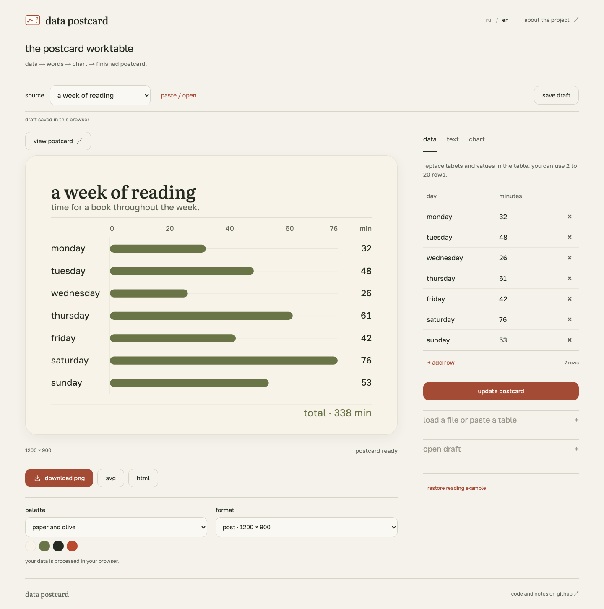
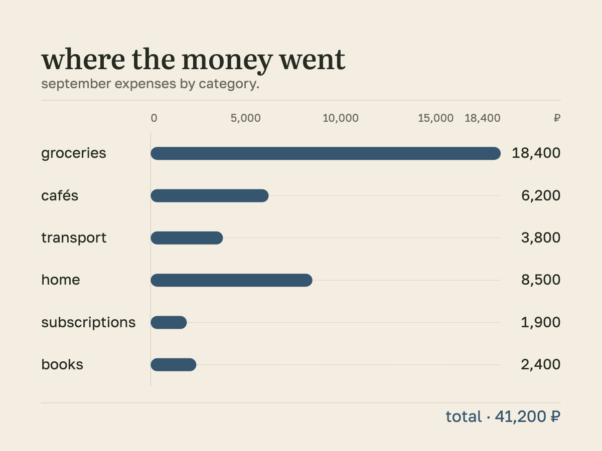
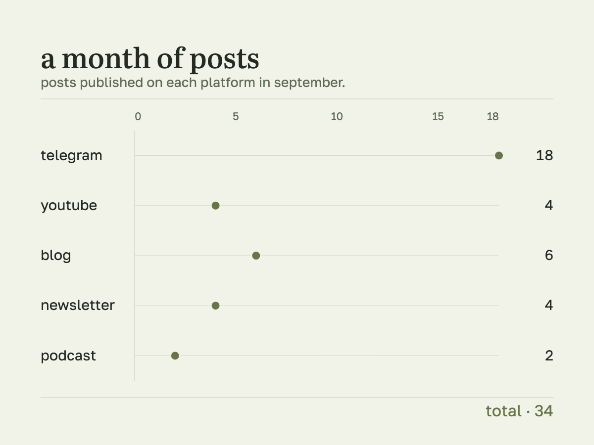
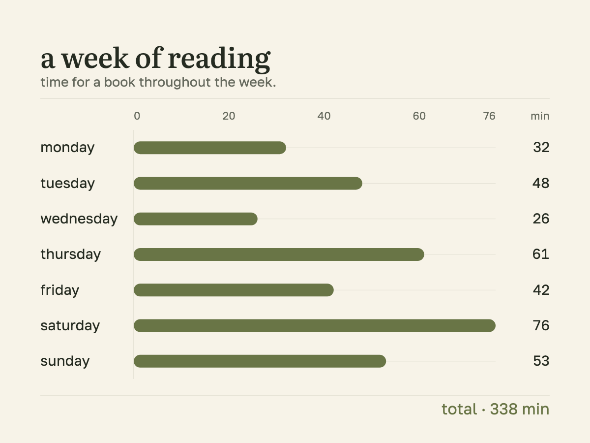
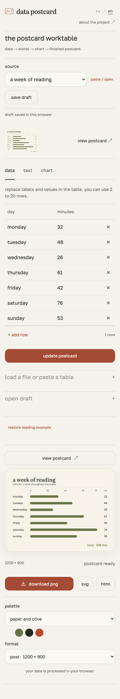

**english** · [русский](README.ru.md)

# data postcard

turn a small table into a chart for a post, report or personal note. enter numbers, add a title and caption, choose a design and download a postcard. five fictional examples let you try the editor before importing your own data.

[open in english ↗](https://chebaturkin.github.io/data-postcard/?lang=en) · [open in russian](https://chebaturkin.github.io/data-postcard/?lang=ru)



## using the editor

1. choose an example and replace the values and labels. add or delete rows, then choose “update postcard”.
2. open “text” to add a title, caption and units.
3. open “chart” to choose a view and its columns. the palette and format sit beside the result. show a total, an average or no summary.
4. download png for publishing, svg for layout work or a standalone html page. downloading applies pending table edits first. errors highlight the cell that needs correcting.

open “load a file or paste a table” to drop csv or json, paste text or copy cells from excel and google sheets. the first row needs column names. csv supports commas or semicolons; copied spreadsheet cells use tabs.

```csv
category,amount
groceries,18400
cafés,6200
transport,3800
```

bars and dots compare values. a line shows changes over time; a calendar shows entries by day. line and calendar views need a date column, for example `2026-10-14`.

formats are **1200 × 900** for posts and **1080 × 1920** for stories. “view postcard” opens a 100% preview. on phones and tablets, the editor comes first, with a compact preview beside the tabs.

choose **ru / en** in the header to switch language in place. a valid `?lang=ru` or `?lang=en` wins over the saved choice, then the first supported browser language, then english. your own text, imported data and pending table cells are kept.

<details>
<summary>example postcards and the mobile editor</summary>

five fictional datasets cover expenses, posts, reading, weather and training. these results were downloaded from the editor.

| expenses by category | posts by platform |
| --- | --- |
|  |  |





</details>

## data and drafts

data is processed in the browser and is not sent to a server. no account is needed. applied data, text and settings are saved in this browser and restored after a reload. pending cells, including errors, are saved separately while the postcard keeps the last valid result.

“restore reading example” brings back the initial dataset. the button above the editor can undo a source replacement or reset. the draft belongs to this browser and site address; clearing site data removes it. if browser storage is blocked, editing continues and the app explains that the draft could not be saved.

“save draft” downloads a `*.postcard.json` file containing data, pending cells, text and settings. “open file” restores it for editing. saved files let you keep several versions or move a postcard to another browser, even when browser storage is unavailable.

png, svg and standalone html use the same scene and embedded local fonts. html also includes an expandable table of applied data. review the contents before sharing an html page or draft file.

## limits

- **2 to 20 rows**; csv, json and draft files up to **1 mb**;
- missing values can remain visible;
- table, file or setting errors keep the previous valid result;
- incompatible settings or text that leaves no room for a chart block export and show a correction;
- reduce large tables to the categories or dates you need; use the 100% preview to check dense charts;
- the browser keeps one automatic draft. downloaded files can hold multiple postcards.

## run locally

this is a static html, css and javascript site. running it needs no build or dependencies:

```bash
python3 -m http.server 8000
```

open the local editor in [english](http://localhost:8000/?lang=en) or [russian](http://localhost:8000/?lang=ru). serve the project directory so the browser can load javascript modules and local fonts.

## checks and captures

```bash
npm test
```

browser checks use the locked development dependency:

```bash
npm ci
npx playwright install chromium
npm run test:browser
node tests/scene-layout-browser.mjs
```

the browser suite starts its own static server. language and export checks use the server from the local-run step:

```bash
python3 -m pip install playwright
python3 -m playwright install chromium
APP_URL=http://localhost:8000/ python3 tests/verify-i18n.py
APP_URL=http://localhost:8000/ python3 tests/verify-export-snapshot.py
```

the suite checks import, errors, current download data, keyboard controls, drafts, portable files, blocked storage, animation and layout from 320 to 1440 px. scene checks cover long text, twenty categories and dates close together. language checks cover defaults, pending edits, errors, exports and persistence. the export regression confirms that a png keeps its starting scene and filename when the editor changes language during image decoding.

refresh both language sets from the running editor:

```bash
APP_URL=http://localhost:8000/ python3 tests/capture-bilingual.py
```

this captures the desktop and mobile editor, downloads three png examples and regenerates all five source datasets and svg results in both languages. russian files are in `docs/images/` and `examples/`; english files are in their `en/` subdirectories.

## source and deployment

[`examples/`](examples/) contains the five csv/json datasets and their svg results. english versions live in [`examples/en/`](examples/en/). `i18n.js` owns the local dictionaries and locale selection; user data keeps its original keys and text.

the [workflow](.github/workflows/pages.yml) publishes `master` to github pages. `src/data.js` and `src/editor.js` handle tables; `src/project.js` handles portable drafts; `src/scene.js` and `src/export.js` render and download the result. [font sources and licences](assets/fonts/README.md) are included with the local font files.
