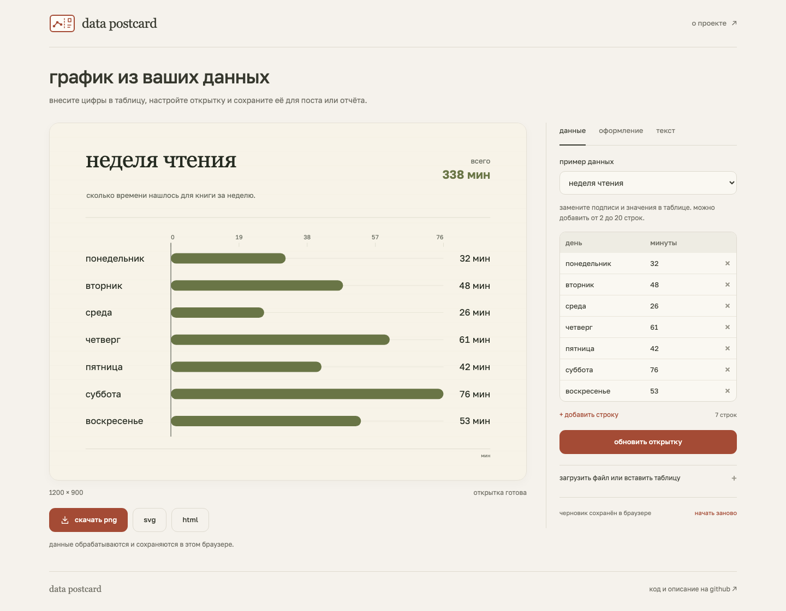
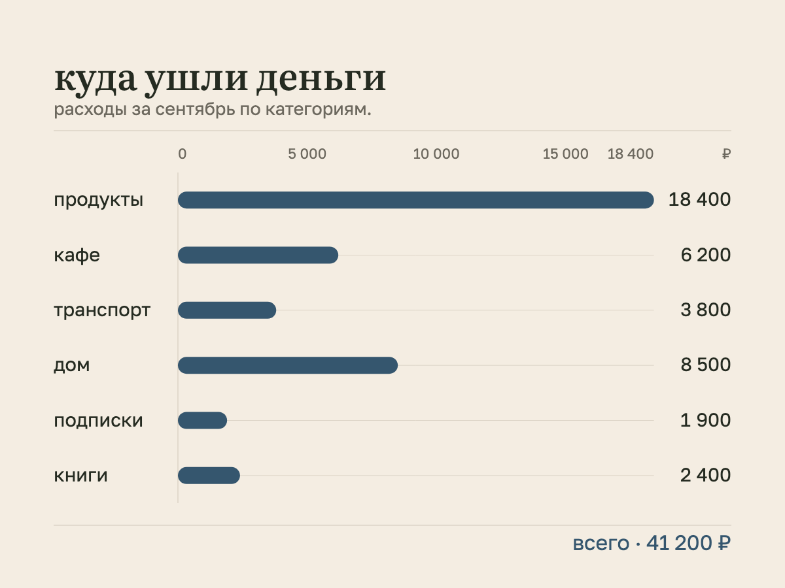
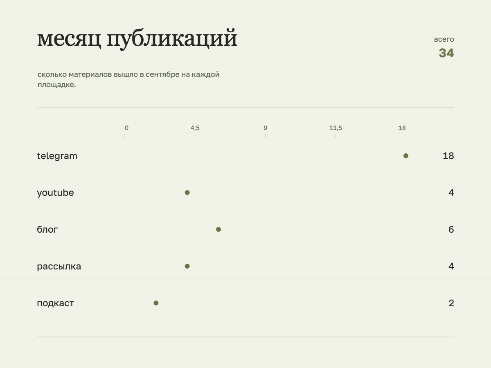
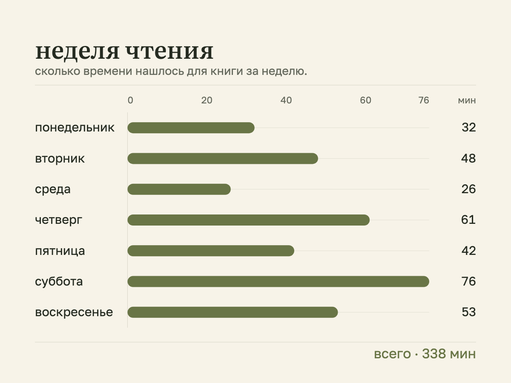
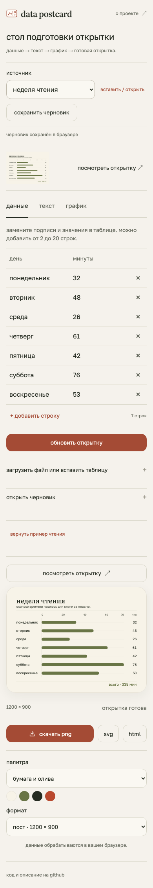

[english](README.md) · **русский**

# data postcard

превратите небольшую таблицу в график для поста, отчёта или личных итогов. внесите цифры, добавьте заголовок и пояснение, выберите оформление и скачайте открытку. пять вымышленных примеров помогут попробовать редактор до загрузки своих данных.

[открыть по-русски ↗](https://chebaturkin.github.io/data-postcard/?lang=ru) · [открыть по-английски](https://chebaturkin.github.io/data-postcard/?lang=en)



язык переключается кнопками **ru / en** в шапке без перезагрузки и потери черновиков. параметр `?lang=ru` или `?lang=en` важнее сохранённого выбора, затем учитывается первый поддерживаемый язык браузера. по умолчанию используется английский. ваши тексты и импортированные данные сохраняют исходный язык.

## как пользоваться

1. выберите пример и замените цифры и названия в таблице. строки можно добавлять и удалять. нажмите «обновить открытку».
2. во вкладке «текст» добавьте заголовок, пояснение и единицы измерения.
3. во вкладке «график» выберите представление и колонки. палитра и формат находятся рядом с результатом. итог можно показать как сумму или среднее либо скрыть.
4. скачайте png для публикации, svg для вёрстки или html, который открывается отдельной страницей. перед скачиванием изменения таблицы применяются автоматически. если есть ошибка, редактор выделит ячейку и предложит её исправить.

если данные уже собраны, раскройте «загрузить файл или вставить таблицу». можно перетащить csv или json, вставить текст или скопировать ячейки из excel и google sheets. первая строка должна содержать названия колонок. csv может использовать запятые или точку с запятой; ячейки из таблицы разделяются табуляцией.

```csv
категория,сумма
продукты,18400
кафе,6200
транспорт,3800
```

полосы и точки помогают сравнить значения. линия показывает изменения по датам, календарь показывает записи по дням. для линии и календаря нужна колонка с датами, например `2026-10-14`.

доступны форматы **1200 × 900** для поста и **1080 × 1920** для сторис. кнопка «посмотреть открытку» открывает результат в масштабе 100%. на телефоне и планшете редактор идёт первым, а компактная миниатюра остаётся рядом с вкладками.

<details>
<summary>примеры открыток и редактор на телефоне</summary>

пять демонстрационных наборов помогают попробовать графики на расходах, публикациях, чтении, погоде и тренировках. ниже результаты, скачанные из редактора; цифры вымышлены.

| расходы по категориям | публикации по площадкам |
| --- | --- |
|  |  |





</details>

## данные и черновик

данные обрабатываются в браузере и не отправляются на сервер. аккаунт не нужен. применённые данные, текст и настройки сохраняются в этом браузере и восстанавливаются после перезагрузки. неприменённые ячейки, включая ошибки, сохраняются отдельно: они появятся в таблице, а открытка сохранит последний корректный результат.

«вернуть пример чтения» возвращает начальный набор. замену источника и возврат примера можно отменить кнопкой сверху. черновик привязан к браузеру и адресу сайта; очистка данных сайта удалит его. если браузер запрещает сохранение, редактор продолжит работать и сообщит об этом.

чтобы перенести открытку в другой браузер или сохранить несколько вариантов, нажмите «сохранить черновик». скачается файл `*.postcard.json` с данными, неприменёнными ячейками, текстом и настройками. «открыть файл» восстановит его для редактирования. сохранение и открытие файла работают и при недоступном хранилище браузера.

png, svg и автономный html используют ту же сцену и встроенные локальные шрифты. html также содержит раскрываемую таблицу применённых данных. перед пересылкой html или файла черновика проверьте данные внутри.

## ограничения

- от **2 до 20 строк**, файлы csv/json и файлы черновиков до **1 мб**;
- пустые значения можно оставить видимыми;
- ошибка в таблице, файле или настройках сохраняет предыдущий корректный результат;
- несовместимые настройки и слишком длинный текст блокируют экспорт. редактор подскажет, что исправить;
- большие таблицы нужно сократить до нужных категорий или периода. плотные данные можно проверить в масштабе 100%;
- автоматический черновик в браузере остаётся один. сохранённые файлы позволяют хранить несколько открыток.

## запустить локально

это статический сайт на html, css и javascript. сборка и установка зависимостей для запуска не нужны:

```bash
python3 -m http.server 8000
```

откройте локальный редактор [по-русски](http://localhost:8000/?lang=ru) или [по-английски](http://localhost:8000/?lang=en). запускайте сервер из папки проекта, чтобы браузер загрузил модули javascript и локальные шрифты.

## проверки и снимки

для тестов парсера, таблицы, черновика, сортировки, графиков и экспорта нужен node.js:

```bash
npm test
```

браузерные проверки используют зафиксированную версию зависимости для разработки:

```bash
npm ci
npx playwright install chromium
npm run test:browser
node tests/scene-layout-browser.mjs
```

основной браузерный сценарий запускает свой статический сервер и проверяет импорт, ошибки, актуальность скачиваемых данных, клавиатуру, черновики, переносимые файлы, недоступное хранилище, анимации и ширины от 320 до 1440 px. отдельный сценарий компоновки проверяет длинные тексты, двадцать категорий и близкие даты.

языковые проверки и проверка экспорта используют сервер из раздела локального запуска:

```bash
python3 -m pip install playwright
python3 -m playwright install chromium
APP_URL=http://localhost:8000/ python3 tests/verify-i18n.py
APP_URL=http://localhost:8000/ python3 tests/verify-export-snapshot.py
```

они проверяют выбор языка, неприменённые ячейки, ошибки, экспорт и сохранение. отдельный сценарий подтверждает, что png сохраняет исходную сцену и имя файла, если переключить язык редактора во время декодирования изображения.

обновить реальные скриншоты и скачанные примеры на двух языках:

```bash
APP_URL=http://localhost:8000/ python3 tests/capture-bilingual.py
```

сценарий снимает редактор на компьютере и телефоне, скачивает три примера png и пересоздаёт все пять исходных наборов и результатов svg на двух языках. русские файлы находятся в `docs/images/` и `examples/`, английские в их подпапках `en/`.

## исходники и публикация

в [`examples/`](examples/) лежат csv/json для пяти примеров и svg с готовыми результатами. английские версии находятся в [`examples/en/`](examples/en/). `i18n.js` отвечает за словари и выбор языка; пользовательские данные сохраняют свои ключи и текст.

[workflow](.github/workflows/pages.yml) публикует ветку `master` на github pages. `src/data.js` и `src/editor.js` работают с таблицей, `src/project.js` с переносимыми черновиками, `src/scene.js` и `src/export.js` с отрисовкой и скачиванием. [источники и лицензии шрифтов](assets/fonts/README.md) сохранены рядом с локальными файлами.
